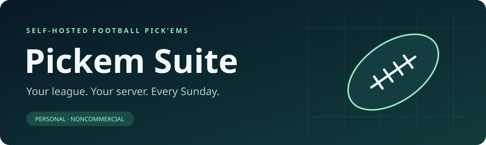

<p align="center"></p>

<p align="center"><strong>A self-hosted football pick’em clubhouse for your friends.</strong><br>Weekly picks. Live game detail. Season-long rivalries. Your own server.</p>

<p align="center"><a href="docs/SETUP.md">Install</a> · <a href="docs/COMMISSIONER.md">Run your league</a> · <a href="docs/PLAYERS.md">Player guide</a> · <a href="docs/NATIVE_INTEGRATION.md">Native integration</a> · <a href="docs/LEGAL.md">Usage & rights</a></p>

> **Personal, noncommercial use only.** This is source-available software. Selling it, paid hosting, subscriptions, ads, commercial redistribution, wagering, and valuable prizes are prohibited by the [license](LICENSE). It is not affiliated with or endorsed by the NFL, its teams, ESPN, or Apple.

## The whole week in one place

| For players | For commissioners |
| --- | --- |
| Weekly picks and a countdown to the next kickoff lock | User management and closed registration by default |
| Hidden opponent picks until each game starts | Manual games, weeks, scoring, and audited overrides |
| Weekly champions and overall season standings | Separate sandbox for rehearsing a week |
| Profiles, records, achievements, and head-to-head history | Announcements, reminder timing, and league preferences |
| Live scores, quarter totals, venue, odds, and game detail with the optional feed | Optional schedule/result sync with an internal worker |
| League chat, reactions, mentions, and web-push reminders | Season archives and operational health information |
| Dark, light, team-color, and OLED themes | PostgreSQL storage and portable Docker deployment |
| Stake-free friendly prediction challenges | Native client API, APNs reminders, and Live Activities backend |

One installation hosts one private league. This is not a multi-tenant SaaS platform. The responsive website can be added to a phone’s home screen. **No iOS app source, Xcode project, binaries, signing files, or Apple credentials are included.** Native server integration remains available for compatible clients you build or obtain separately.

## Quick start

Requires Docker Engine/Desktop with Compose v2+, Git, OpenSSL, and a POSIX shell. A Linux host with at least 2 CPU cores, 4 GB RAM and 10 GB free disk is a practical starting point; builds need more space than the running app.

```sh
git clone https://github.com/dbzx6r/pickem-suite.git
cd pickem-suite
sh scripts/configure.sh
# Edit .env: APP_URL, ADMIN_EMAIL, LEAGUE_NAME, and optionally SEASON_YEAR.
docker compose build
docker compose run --rm setup
docker compose up -d
docker compose ps
```

Visit **http://localhost:3000** on the host. Sign in with `ADMIN_EMAIL` and the randomly generated `ADMIN_SEED_PASSWORD` in your private `.env`; change the password when prompted. Remove the bootstrap password from `.env` afterward. Create players and your first week in the commissioner tools. The initial season is empty—no real participants, copied league history, or invented live games are seeded.

The app binds to loopback. For another device or internet access, configure HTTPS through your own reverse proxy and set `APP_URL` to its exact public origin. Follow the [full setup guide](docs/SETUP.md); simply changing the URL does not expose the app.

## Choose your content

The default installation uses text team badges and commissioner-managed games. It makes no sports-feed requests. No official team logo files or news archives are bundled.

- `ENABLE_ESPN_DATA=true` enables the optional ESPN feed adapter for schedules/results and game detail. The upstream interface is unofficial, may change, and comes with no access or redistribution license from this project.
- `NEXT_PUBLIC_TEAM_LOGOS_ENABLED=true` enables remotely loaded official team logos. **Rebuild the app** after changing this flag.
- News also requires the commissioner’s news setting. APNs and web push require your own credentials.

Enable third-party content only if you have the necessary permissions. Noncommercial use, attribution, hotlinking, or a disclaimer alone does **not** establish those permissions. Read [Legal & third-party rights](docs/LEGAL.md).

## Documentation

| Guide | Covers |
| --- | --- |
| [Setup](docs/SETUP.md) | Docker, configuration, HTTPS, first login, troubleshooting |
| [Commissioner](docs/COMMISSIONER.md) | Players, schedules, scoring, seasons, sandbox, reminders |
| [Players](docs/PLAYERS.md) | Picks, tiebreakers, standings, chat, profiles, challenges |
| [Operations](docs/OPERATIONS.md) | Backup, restore, updates, monitoring, privacy |
| [Native integration](docs/NATIVE_INTEGRATION.md) | API authentication, capabilities, APNs configuration |
| [Development](docs/DEVELOPMENT.md) | Local development, tests, repository layout |
| [Legal](docs/LEGAL.md) | Personal-use scope, branding/data rights, no wagering |
| [Security](SECURITY.md) | Supported deployment scope and private reporting |

## What this repository contains

```text
src/                 Website, server routes, native API, league rules
prisma/              Schema, clean initial migration, safe admin bootstrap
public/              Original app icons and web app assets
scripts/             Setup, scheduler, and synthetic test helpers
tests/               Rule tests and browser regression tests
docs/                Installation, operation, integration, and usage guides
compose.yaml         App, PostgreSQL, and internal scheduler
compose.apns.yaml    Optional read-only APNs key mount
```

This publication starts with fresh Git history. It contains no production database, participant exports, avatars, chat history, deployment backups, private domains, or credentials. Do not contribute those files in issues or pull requests.

## Contributing and licensing

Read [CONTRIBUTING.md](CONTRIBUTING.md) before sending a change. Contributions to original project code use the same personal noncommercial license. Dependencies and upstream UI components retain their own licenses; see [THIRD_PARTY_NOTICES.md](THIRD_PARTY_NOTICES.md). No warranty, guaranteed sports-feed availability, or hosted service is provided.
